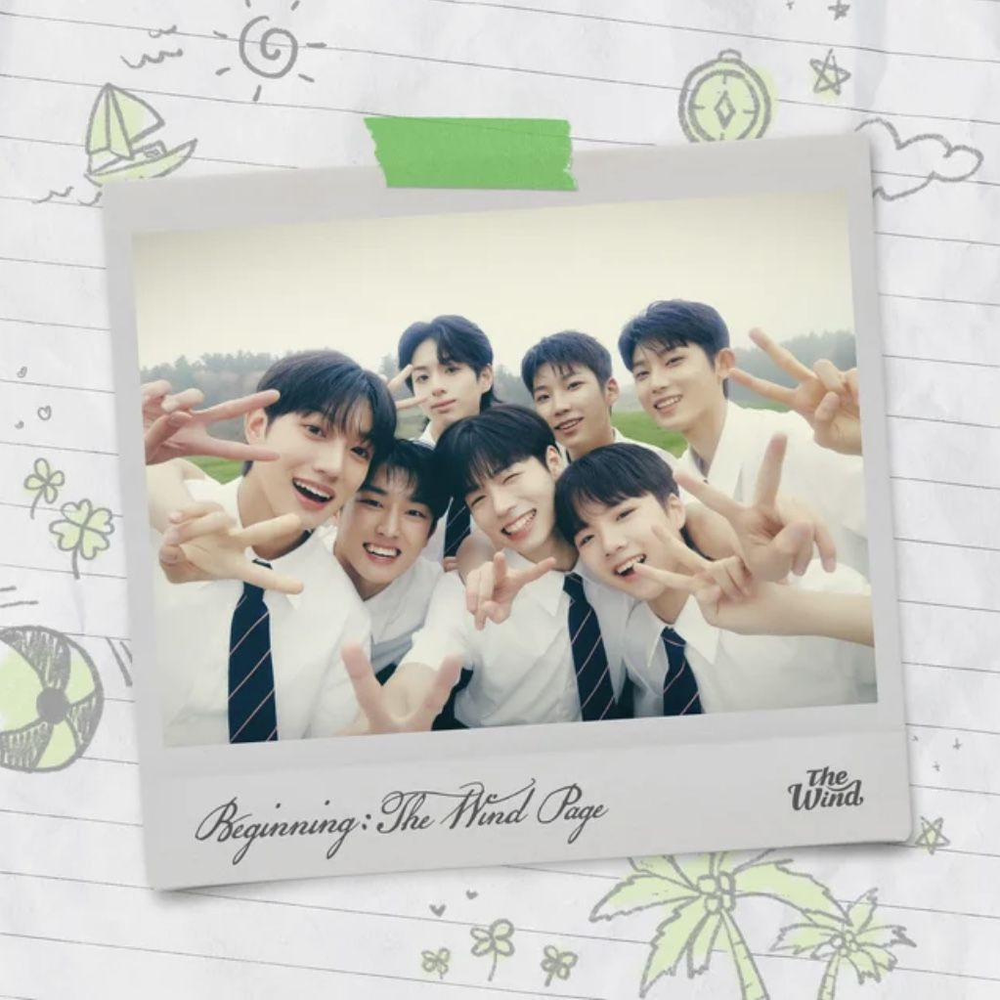

# JavaForThree 🎓

This is a repository dedicated to **ICT 11-03** — the class I had the privilege of teaching during my ST journey. This contains activity files, performance tasks, and resources from our Computer Programming 1 sessions. Happy Teacher's Day, Sir Juls pogi!

---

## 🗂️ Repository Structure

```
JavaForThree/
└── 2Q_Surname_ICT 3/
    ├── build.xml
    ├── manifest.mf
    └── src/
        ├── a_Second_Session/
        │   ├── Flags.java
        │   └── SimpleATM.java
        ├── b_Second_Session/
        ├── Condition_Loop/
        │   ├── Conditions.java
        │   ├── DoWhileLoopDemo.java
        │   ├── ForLoopDemo.java
        │   ├── InitialDoWhile.java
        │   ├── LoopControlDemo.java
        │   ├── NestedLoopDemo.java
        │   └── WhileLoopDemo.java
        ├── Input_Output.java
        ├── KeyboardBuffer.java
        ├── PrintF.java
        └── Quiz_ICT_Codes/
            ├── Item01.java
            ├── Item02.java
            ├── Item03.java
            ├── Item04.java
            ├── Item05.java
            ├── Item06.java
            ├── Item07.java
            ├── Item08.java
            ├── Item09.java
            ├── Item10.java
            ├── Item11.java
            ├── Item12.java
            ├── Item13.java
            ├── Item14.java
            ├── Item15.java
            ├── Item16.java
            ├── Item17.java
            ├── Item18.java
            └── Item19.java
```

---

## 🌟 Accepted Recitation Stickers

The recitation stickers given will be part of your recitation score in Computer Programming 1. The following sticker designs are officially accepted:

| Sticker 1 | Sticker 2 | Sticker 3 |
|-----------|-----------|-----------|
|  |  |  |

> **⚠️ Stickers without my signature will not be honored.**
> Each sticker must bear my personal signature on the lower part to be considered valid.

---

## 💌 A Note of Gratitude

To every student of **ICT 11-03**,

Thank you very much.

Being your student teacher was one of the most memorable experiences of my academic life. Last year, I was not able to teach this section due to some circumstances, and I can say that I am very lucky to have you all. You were patient with me, attentive, and you made every session fun to prepare for.

I may have been the one standing in front of the class, but truthfully, you taught me just as much. About patience, about how to explain things better, and about why teaching is worth it.

I hope the things we learned together stick with you, not just for the grade, but because you actually get it now. 🙂

Keep coding. Huwag matakot, at huwag mahihiyang magtanong. :)

— *Sir Gab* 🎓

---

*Happy learning!*
